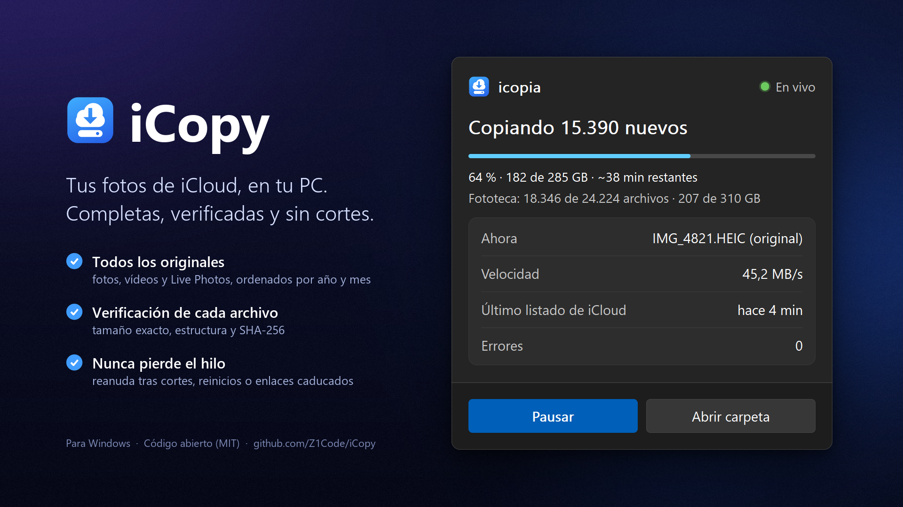
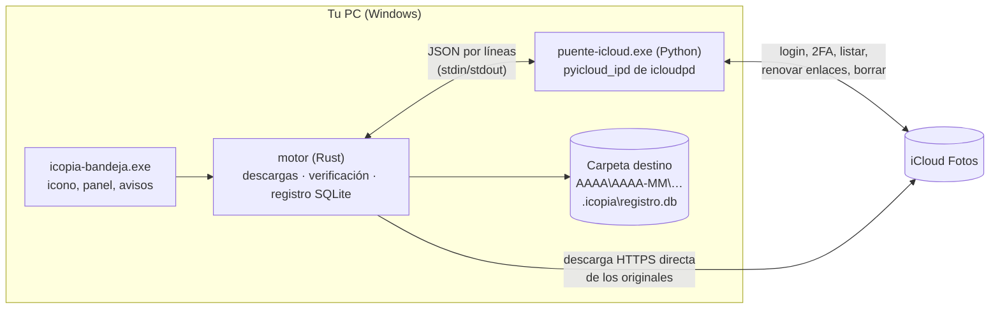

<p align="center">
  
</p>

# iCopy

[](https://github.com/Z1Code/iCopy/actions/workflows/ci.yml) [](https://github.com/Z1Code/iCopy/releases/latest)

**Copia de seguridad de iCloud Fotos para Windows y Mac: completa, verificada y sin cortes.**

iCopy (internamente `icopia`) es una app de la bandeja de Windows y de la barra de menús de macOS
(beta) que baja **todos los originales**
de tu fototeca de iCloud a una carpeta de tu PC o disco externo, comprueba cada archivo antes de darlo
por bueno y retoma sola donde se quedó después de cualquier corte. Cuando todo está a salvo, y solo si
tú lo confirmas, puede liberar espacio en iCloud.

## El problema

Con **Fotos en iCloud + "Optimizar almacenamiento"** el iPhone solo guarda versiones reducidas; los
originales viven en iCloud. Copiar por USB en Windows (Explorador, app Fotos) se cuelga o queda
incompleto: el iPhone intenta bajar cada original de iCloud y convertir HEIC→JPG sobre la marcha, y
pide permiso en cada conexión. Mientras tanto, iCloud sigue cobrando por todo lo acumulado.

iCopy no usa el cable: habla directamente con iCloud, como la web de iCloud.

## Qué hace

- **Todos los originales**: fotos, vídeos, el vídeo de las Live Photos y las ediciones, ordenados en
  `AAAA\AAAA-MM\` según la fecha de captura. Nombres que chocan → sufijo con el id (`IMG_0001 (ab12cd).HEIC`).
- **Verificación de cada archivo**: tamaño exacto, estructura completa del contenedor (JPEG, PNG,
  HEIC/MOV/MP4) y SHA-256 releído del disco. Los originales con estructura atípica se confirman
  bajándolos **dos veces** y comparando los bytes.
- **Nunca pierde el hilo**: escribe en `.part` y solo renombra tras verificar; reanuda tras cortes de
  luz, de red o reinicios; nunca duplica. Los enlaces de descarga de iCloud caducan a los ~15 minutos:
  iCopy los renueva por tandas antes de que caduquen, sin volver a listar toda la fototeca.
- **Panel en vivo**: al pasar el ratón o hacer clic en el icono, un panel muestra la ronda en curso
  (barra, % y GB), el total de la fototeca, la velocidad, el tiempo restante y el archivo actual.
- **Desatendida**: arranca con Windows, revisa iCloud cada pocas horas, evita la suspensión mientras
  copia, avisa con notificaciones (terminado, errores, sesión caducada, disco lleno o desconectado).
- **Liberar espacio (opcional)**: borra de iCloud solo lo ya copiado y verificado, con varias capas
  de seguridad (abajo).

## Cómo funciona



- **Rust** hace lo pesado y lo crítico: descargas concurrentes, verificación, registro (SQLite en modo
  WAL dentro de `<destino>\.icopia\`), reanudación, interfaz.
- **Python** solo habla con Apple, usando la librería `pyicloud_ipd` del proyecto
  [icloudpd](https://github.com/icloud-photos-downloader/icloud_photos_downloader) con versión fija,
  empaquetada como un único `.exe`.
- Cada parte pasa por `pendiente → descargando → descargado → verificado`; los fallos se reintentan con
  espera creciente y, si persisten, en la ronda siguiente.

En la carpeta destino:

```
<destino>\2024\2024-07\IMG_4521.HEIC
                       IMG_4521.MOV               (vídeo de la Live Photo)
                       IMG_4521 (editada).HEIC    (si hay edición)
<destino>\.icopia\registro.db, logs\, borrados.csv
```

## Garantías de seguridad

iCopy **nunca borra nada de iCloud por su cuenta**. "Liberar espacio" es un paso aparte y:

1. Solo considera elementos con **todas** sus partes verificadas.
2. **Vuelve a verificar en disco** justo antes de borrar (existe, tamaño, SHA-256).
3. Te muestra un resumen (n.º de archivos, GB, rango de fechas, excluidos y por qué) y exige una
   confirmación explícita: en la ventana, marcar la casilla y **mantener pulsado** el botón 2 s; en la
   consola, escribir **`BORRAR`**.
4. **Conserva siempre los últimos 30 días** en iCloud, por fecha de captura y por fecha en que se añadió
   (aunque elijas años concretos).
5. **Nunca toca la Fototeca Compartida** de iCloud, ni lo que tenga datos que icopia aún no sabe copiar.
6. Lo borrado va a **"Eliminado recientemente"**, donde Apple lo guarda 30 días, y **se puede restaurar**:
   botón «Restaurar este borrado» al terminar o `icopia restaurar --ultima`.
7. Nunca borra nada del PC. Trabaja en tandas de 50, a un ritmo suave: si Apple pide esperar (HTTP 503 o
   `TRY_AGAIN_LATER`), espera cada vez más y reintenta, sin dar nada por fallido por ello. Anota cada
   borrado en `borrados.csv` con el identificador de la liberación.

## Instalación

1. Descarga **`iCopy-Setup-X.Y.Z.exe`** de [Releases](https://github.com/Z1Code/iCopy/releases/latest) y ábrelo.
2. Windows puede mostrar «SmartScreen: editor desconocido», porque el instalador aún no lleva firma de
   Windows. Pulsa **Más información → Ejecutar de todas formas**. Cada versión sí va firmada con una
   clave propia y las actualizaciones la comprueban (abajo).

Requisitos: Windows 10 u 11 (probado en Windows 11). No pide permisos de administrador: instala en
`%LOCALAPPDATA%\Programs\icopia\`, añade iCopy al menú Inicio, puede arrancar con Windows y se
desinstala desde *Configuración → Aplicaciones* (tus fotos, tu configuración y tu sesión se conservan;
el desinstalador te pregunta si quieres borrar también la configuración y la sesión).

Al primer arranque, elige la carpeta destino e inicia sesión en la ventana de iCloud (Apple ID,
contraseña y el código de 6 dígitos de tu iPhone). La contraseña no se guarda; la sesión sí, en
`%APPDATA%\icopia\sesion\`, y la configuración en `%APPDATA%\icopia\config.json`.

### Actualizaciones

iCopy busca versiones nuevas al arrancar y una vez al día en [Releases](https://github.com/Z1Code/iCopy/releases).
Descarga el instalador en segundo plano y **solo lo usa si su firma es válida**. Por defecto lo instala
solo cuando no hay nada en marcha (ni copia, ni pausa, ni «Liberar espacio», ni ventanas abiertas) y
se vuelve a abrir. Nunca actualiza mientras se borra en iCloud. En el menú del icono puedes
desactivar *Actualizar automáticamente* (te avisa y tú eliges cuándo: *Reiniciar y actualizar*) o
pulsar *Buscar actualizaciones*. Los cambios de cada versión están en el [CHANGELOG](CHANGELOG.md).

### En Mac (beta)

Requisitos: macOS 13 o posterior en un **Mac con Apple Silicon** (M1 o posterior).

1. Descarga **`iCopy-X.Y.Z-macos-arm64.dmg`** de [Releases](https://github.com/Z1Code/iCopy/releases/latest),
   ábrelo y arrastra **iCopy** a **Aplicaciones**. La app está firmada y notarizada por Apple: se abre sin
   avisos de «desarrollador no identificado».
2. Ábrela: aparece un icono en la **barra de menús** (arriba a la derecha), no en el Dock. Al primer
   arranque elige la carpeta destino e inicia sesión en iCloud.
3. La primera vez que copie a un disco externo, a Documentos o al Escritorio, macOS te pedirá permiso
   para que iCopy acceda a esa carpeta: acéptalo.

En el menú del icono ves el estado de la copia y tienes Copiar ahora, Pausar, Verificar todo, Abrir
carpeta, Cambiar destino, Iniciar sesión, **Abrir al iniciar sesión** y las actualizaciones (se
instalan solas igual que en Windows, comprobando la firma de iCopy y la de Apple). «Liberar espacio en
iCloud» llega a Mac en la próxima versión.

La configuración y la sesión se guardan en `~/Library/Application Support/icopia/`.

### Desde el código

Requisitos: [Rust](https://rustup.rs) (toolchain MSVC), Python 3.11 y Git.

```powershell
git clone https://github.com/Z1Code/iCopy.git
cd iCopy
py -3.11 -m venv puente\.venv
puente\.venv\Scripts\pip install -r puente\requirements.txt
.\instalar.ps1      # compila e instala directamente
.\empaquetar.ps1    # o genera dist\iCopy-Setup-X.Y.Z.exe (necesita Inno Setup 6)
```

`instalar.ps1`:

- empaqueta el puente de Python con PyInstaller (`puente\dist\puente-icloud.exe`);
- compila en release `icopia.exe`, `icopia-bandeja.exe` e `icopia-login.exe`;
- los copia a `%LOCALAPPDATA%\Programs\icopia\`;
- registra el arranque con Windows (`HKCU\...\Run`, valor `icopia`; se desactiva desde el menú);
- abre la app en la bandeja.

## Uso

**Icono de la bandeja**: pasa el ratón o haz clic para ver el panel de progreso. Clic derecho:

| Menú | Qué hace |
| --- | --- |
| Copiar ahora / Pausar | Lanza una ronda o la detiene (se reanuda donde estaba) |
| Verificar todo | Vuelve a comprobar todo lo copiado |
| Liberar espacio en iCloud… | Abre el asistente para borrar de iCloud lo verificado (con las garantías de arriba) |
| Abrir carpeta de fotos | Abre la carpeta destino |
| Cambiar destino… | Elige otra carpeta o disco |
| Iniciar sesión en iCloud… | Abre la ventana de inicio de sesión (2FA) |
| Iniciar con Windows | Activa o desactiva el arranque automático |
| Actualizar automáticamente | Instala solas las versiones nuevas cuando no hay nada en marcha |
| Buscar actualizaciones | Busca ahora; si hay una lista, «Reiniciar y actualizar a X.Y.Z» |

**Liberar espacio en iCloud** (menú, o botón «Liberar espacio» del panel con la copia al día) abre un
asistente en cinco pasos: *Elegir* (conservar los últimos 30 días, 3, 6 o 12 meses, 2 o 3 años, o
marcar años de captura, con el resumen al instante), *Revisar* (vuelve a listar iCloud y re-verifica en
disco; «Ver lista» abre el plan en CSV), *Confirmar*, *En marcha* (pausar o cancelar; se puede cerrar la
ventana y el borrado sigue) y *Resultado* (con «Restaurar este borrado»).

Mientras se libera espacio (desde el asistente o con `icopia liberar`), el panel muestra una segunda barra
con la fase (consultando iCloud, comprobando archivos en disco, borrando), el avance, los GB y el
tiempo restante; el tooltip del icono también lo dice. Al terminar queda un resumen durante 24 h
(lo liberado, los fallos si los hubo y el recordatorio de vaciar «Eliminado recientemente»), y si el
proceso se cierra a medias se muestra como interrumpido.

**Línea de comandos** (`icopia.exe`):

```
icopia --version                Muestra la versión
icopia destino <carpeta>       Fija la carpeta donde se guardan las fotos
icopia login                   Inicia sesión en iCloud (contraseña + código 2FA)
icopia diagnostico             Comprueba la sesión y que las descargas funcionan
icopia copiar [--mes AAAA-MM]  Copia y verifica lo que falte
icopia estado                  Resumen de lo copiado
icopia verificar               Vuelve a comprobar todo lo copiado
icopia liberar [--dias N | --anios 2011-2019,2021 | --hasta-anio 2025]
                               Borra de iCloud lo ya copiado y verificado (pide confirmación)
icopia restaurar --ultima | --sesion ID
                               Saca de "Eliminado recientemente" lo de una liberación
```

La interfaz está en español o en inglés según el idioma de Windows (`ICOPIA_IDIOMA=es|en` lo fuerza).
Para cuentas de iCloud de China continental, pon `"dominio": "cn"` en `config.json`.

## Desarrollo

```powershell
cargo test --manifest-path icopia\Cargo.toml          # motor, verificación, reglas de borrado
puente\.venv\Scripts\python -m pytest puente\tests    # puente de Python
cargo run --manifest-path icopia\Cargo.toml --example panel_demo -- panel.png 1.5
```

Las pruebas usan un iCloud falso (puente simulado + servidor HTTP local con cortes): no necesitan cuenta.
Las imágenes de `docs/social/` se regeneran con `python docs/social/generar.py` (Pillow; datos de ejemplo).
Para agentes de IA: ver [AGENTS.md](AGENTS.md).

## Limitaciones

- Solo Windows.
- Necesita un Apple ID con verificación en dos pasos (lo normal hoy).
- Con **Protección avanzada de datos** (ADP) activa, hay que habilitar en el iPhone
  *Ajustes → [tu nombre] → iCloud → "Acceder a datos de iCloud en la web"*.
- Los enlaces de descarga de iCloud caducan en ~15 minutos; iCopy lo gestiona solo, pero una conexión
  muy lenta con archivos enormes puede necesitar varias rondas.
- Usa la API web no oficial de iCloud: si Apple la cambia, puede dejar de funcionar hasta que se actualice
  `icloudpd`.
- **No está afiliado ni respaldado por Apple.** iCloud, iPhone y Live Photos son marcas de Apple Inc.

## Créditos

- [icloudpd / pyicloud_ipd](https://github.com/icloud-photos-downloader/icloud_photos_downloader) (MIT): autenticación y API de iCloud.
- Crates de Rust: `reqwest`, `rusqlite`, `sha2`, `tray-icon`, `tao`, `native-windows-gui`, `windows-sys`,
  `tauri-winrt-notification`, `rfd`, `serde`, `chrono`, `anyhow`, entre otros (ver `icopia/Cargo.toml`).
- Empaquetado del puente con [PyInstaller](https://pyinstaller.org).

## Licencia

[MIT](LICENSE) © 2026 Z1Code

---

## English summary

**iCopy** is a Windows tray app (and, in beta, a macOS menu bar app for Apple Silicon) that backs up **all original photos and videos** from iCloud Photos to a
local folder (`YYYY\YYYY-MM\`). It exists because, with "Optimize iPhone Storage" on, USB copies on
Windows hang or come out incomplete. iCopy talks to iCloud directly, verifies every file (exact size,
container structure, SHA-256; atypical originals are confirmed by downloading twice), resumes after any
interruption, and renews iCloud's ~15-minute download links in batches. A hover/click flyout shows live
progress, speed and ETA. Optionally it frees iCloud space, deleting **only** re-verified items after you
type `BORRAR`, keeping the last 30 days and never touching the Shared Library (deleted items stay 30 days
in "Recently Deleted"). Built with Rust plus a small Python bridge using icloudpd's `pyicloud_ipd`.
UI is in Spanish and English. Windows: per-user installer (`iCopy-Setup-X.Y.Z.exe`); Mac: signed and notarized `.dmg`. Both update themselves, verifying each release signature (and, on Mac, Apple's signature and Team ID). Not affiliated with Apple. MIT licensed.
